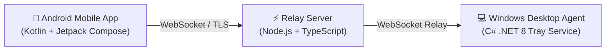

# AutoFlow — Remote Laptop Control 🔒⚡

> **Secure, biometric-guarded remote control system for Windows laptops via an Android companion app with 1-to-1 dynamic cryptographic token pairing and a silent background system tray agent.**

---

## 🌟 Key Capabilities

- 🛡️ **Instant Win32 Power Commands:** Direct execution of `LockWorkStation()` and `powrprof.dll` standby mode with sub-15ms relay latency.
- 👆 **Hardware Biometric Safeguards:** Destructive commands (Restart and Shutdown) require native Android `BiometricPrompt` fingerprint or device lock verification.
- 🪟 **Silent Windows System Tray Service:** Minimizes directly into the Windows taskbar notification area with right-click menu controls and 1-click **Start with Windows** persistence.
- 🔑 **5-Second Dynamic 6-Digit PIN Pairing:** No hardcoded secrets. Generate a temporary 6-digit PIN on your laptop and verify on your phone to exchange a 256-bit cryptographic token.
- 🔒 **Strict 1-to-1 Device Isolation:** Any foreign device attempting command dispatch without a bound cryptographic token is instantly blocked.
- ⚡ **Zero-Database Architecture:** Lightweight disk persistence for pairing tokens, requiring zero paid database add-ons for cloud hosting.

---

## 🏗️ Architecture



| Component | Stack | Purpose |
| :--- | :--- | :--- |
| **Relay Server** | Node.js, TypeScript, WebSocket (`ws`) | Public landing page, binary download host, pairing validator, and real-time command relay. |
| **Windows Desktop Agent** | C# .NET 8, Windows Forms, Win32 APIs | Runs in Windows notification area, executes system power calls, generates pairing codes. |
| **Android Companion App** | Kotlin, Jetpack Compose, BiometricPrompt, OkHttp | User cockpit for 1-tap lock/sleep and fingerprint-guarded restart/shutdown. |

---

## 🚀 Quick Start Guide

### 1. Relay Server
```bash
cd server
npm install
npm run build
npm start
```
- Open `http://localhost:8080` to view the landing page and download portal.
- Health telemetry endpoint: `http://localhost:8080/health`.

### 2. Windows Desktop Agent
- **Standalone:** Run `RemoteLaptopAgent.exe --tray` (or double-click `Start-Tray.bat`).
- **From Source:**
  ```powershell
  cd windows-agent
  .\run.bat --tray
  ```
- Right-click the tray icon and select **"Pair New Phone..."** to display your 6-digit PIN.

### 3. Android Mobile App
- Install `RemoteLaptopControl.apk` on your Android device (Android 8.0+).
- Open the app, enter the 6-digit PIN displayed on your laptop, and tap **Connect**.
- Workstation commands become active immediately!

---

## ☁️ Cloud Deployment (Render / Railway)

1. Connect this repository to **[Render](https://render.com)** as a **Web Service**.
2. Set **Root Directory** to `server`.
3. Set **Build Command** to `npm install && npm run build`.
4. Set **Start Command** to `npm start`.
5. Set **Health Check Path** to `/health`.

---

## 📄 License

Open Source under the MIT License.
